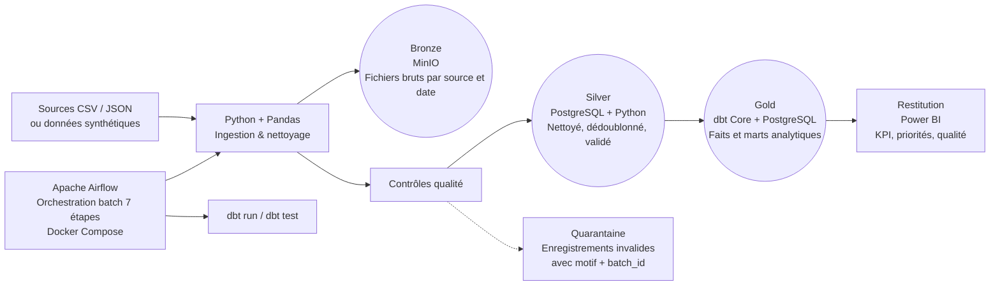

# RadioCare — Architecture v1 (M1.9)

## Diagramme (Mermaid)

## Flux de données (7 étapes Airflow, §F5 du CDC)
1. Vérification des entrées.
2. Ingestion des données (lecture CSV/JSON, batch_id, stockage brut MinIO).
3. Contrôles de qualité (quarantaine des enregistrements invalides).
4. Chargement des tables structurées (PostgreSQL Silver).
5. Exécution des modèles dbt (staging → intermediate → marts Gold).
6. Tests des modèles analytiques.
7. Enregistrement du résultat de l'exécution (`pipeline_runs`).

## Stack technologique (§7.1 du CDC)
- Python, Pandas : ingestion et logique métier.
- PostgreSQL : stockage relationnel et analytique.
- MinIO : stockage objet (couche Bronze).
- Apache Airflow : orchestration batch.
- dbt Core : transformations SQL et tests.
- Docker Compose : environnement reproductible.
- Git / GitHub Actions : versionnement et CI/CD.
- pytest : tests unitaires et d'intégration.
- Power BI : visualisation des indicateurs.

## Conteneurs (docker-compose.yml)
- `postgres` : base de données relationnelle (Silver / Gold).
- `minio` : stockage objet (Bronze).
- `airflow` : webserver + scheduler (orchestration).
